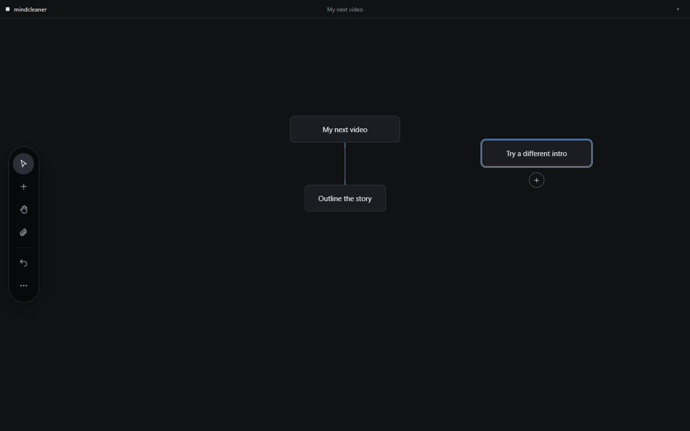

# Mind Cleaner

A local-first desktop canvas for connected thoughts. Built with Rust + Tauri and a dependency-free frontend. It reopens your last active map, with a floating tool island centered on the left. New workspaces start on a blank canvas; saved maps stay available inside More tools.



## What's new

- Blank canvas, independent thoughts, and an expanding left tool island. Settings and AI stay hidden until requested.
- Double-click or press N to write. The + on any of the four edges adds a text, voice, image, file or AI child. Drop a thought on another’s + to attach the whole subtree, with a preview and undo.
- English canvas-first interface with dark/light themes. Map text supports Persian and other languages.
- Choose **soft or angular connections**, independently of **rounded or sharp branch shapes**.
- Spring entrances, drawing connections and sliding panels; respects reduced motion.
- Four-direction layouts, pan/zoom, fit view, drag, multiple selection and reparenting.
- Map/outline views, notes, tasks, colors, files, images, audio/video playback and voice recording.
- Undo/redo, search through collapsed thoughts, duplicate/delete maps, focus mode and keyboard shortcuts.
- AI drafts with preview, accept/discard and cancellation, bound to the original target.
- JSON import/export, PNG export of visible branches, and Markdown outlines.
- Serialized autosave, error feedback and a backup of the previous desktop save.

## Run locally

Node.js 20+ is required. Desktop development also needs Rust and the [Tauri prerequisites](https://v2.tauri.app/start/prerequisites/).

```sh
npm install
npm run preview      # Browser preview at http://127.0.0.1:4173
npm run dev          # Native Tauri app
npm run build        # Native installers for the host OS
npm test             # Document/layout/history tests
npm run test:ui      # Playwright UI tests (Microsoft Edge installed)
```

No frontend bundler or runtime package download is needed. Browser preview uses local storage; desktop mode uses files. These are separate workspaces. Browser storage has a quota; use the desktop app for larger attachments.

## Your existing maps

The app first looks for `canvas-workspace.json`. If absent, it imports `studio-workspace.json`, or falls back to the original `workspace.json`. Those earlier files are preserved. New saves use `canvas-workspace.json`, with the previous save at `canvas-workspace.backup.json`. Every launch restores the last active map without creating an extra empty map. Other maps remain under **More tools → Saved maps**.

| Platform | Installed data location |
|---|---|
| Windows | `%APPDATA%\MindCleaner` |
| macOS | `~/Library/Application Support/MindCleaner` |
| Linux | `~/.local/share/MindCleaner` |

Portable mode uses a `data` folder beside the executable if it exists. Legacy JSON maps can also be opened from **More tools → Saved maps → Import a map**. If a workspace cannot be read, recovery mode disables autosave to protect it. Restore the original file or export any recovery work before closing.

Desktop attachments are copied locally when possible, with the existing backend's large-file fallback to a linked path. JSON exports embed existing data URLs but retain paths for linked files: keep attachment files when moving an export. PNG exports show currently visible branches; expand collapsed branches first for a complete map.

## AI

Use a thought’s **+ → AI** to generate children, including a requested count in your prompt. **Right-click → Edit with AI** rewrites only that box while preserving its children, notes, styling and attachments. The AI panel also offers a new-map destination. Drafts stay bound to the original thought and require acceptance; cancellation and undo are supported. Clicking the canvas dismisses any open panel and retains the AI prompt.

Open **More tools → AI assistant → AI connection** for OpenRouter, OpenAI, Google AI Studio, Anthropic and custom/Ollama endpoints. **Refresh** discovers chat models, groups free models and records whether recent requests succeeded. Auto tries another model after availability or rate-limit errors; OpenRouter Auto defaults to free models only. Listed models are not assumed tested until a request succeeds. You can also enter a model ID manually.

**Import from PromptPad** reads the installed app’s `promptpad-data.json` and imports all provider keys, the selected model, cached models and custom endpoint. **Choose data file** supports a portable installation or a JSON backup. No notes or other PromptPad content are imported. Model discovery refreshes after import and after changing credentials.

On Windows desktop, connection settings and keys are saved separately using Windows account encryption. Keys are excluded from workspace files and map exports. Browser preview and non-Windows desktop retain keys only for the session. Native requests bypass browser CORS restrictions and support cancellation. Automated AI tests use local or mocked providers; live external-provider access requires your credentials.

Attachments appear as individual rows below text or images, showing the filename and format. Click to open, use the row’s × to remove it, or right-click for **Open in folder**, replace and delete. Removing an attachment is undoable and does not delete the underlying file. Browser preview downloads attachments; opening their folder requires a desktop file path.

## Shortcuts

Double-click empty canvas or press N to create an independent thought. Tab adds a text child. New canvases grow to the right by default. Shift+Tab adds a sibling. Enter/F2 edits, and Shift+Enter inserts a line while editing. Ctrl+click selects multiple thoughts. Shift+drag selects a region. Drop a thought onto another’s + on any edge to reparent its subtree. Scroll zooms at the cursor. Drag empty canvas or Space+drag to pan. Ctrl+Z undoes, and Ctrl+Shift+Z redoes. Right-click a thought to change its color or toggle its task checkbox. Open **More tools → Thought details** for notes, attachments, and detach. F toggles focus. More tools contains the full shortcut list.

## Source layout

- `studio/`: new application, document model, persistence bridge, SVG brand assets and styles.
- `ui/`: preserved legacy frontend.
- `src-tauri/`: native dialogs, storage, attachments and window controls.
- `tests/`: unit and browser interaction coverage.
- `design/`: visual concepts and screenshots of the working application.

GitHub releases remain tag-driven through the existing workflow. Building locally does not publish a release.

MIT licensed.
